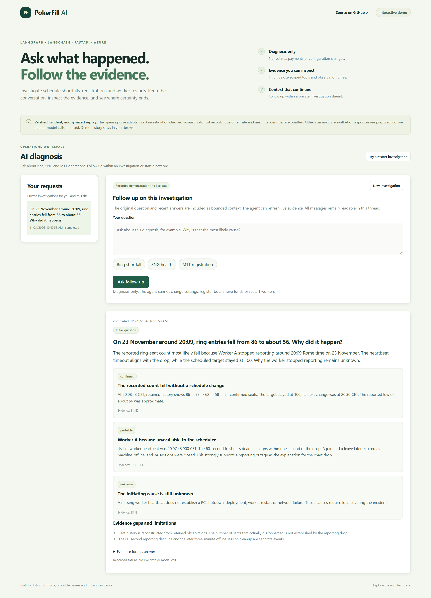
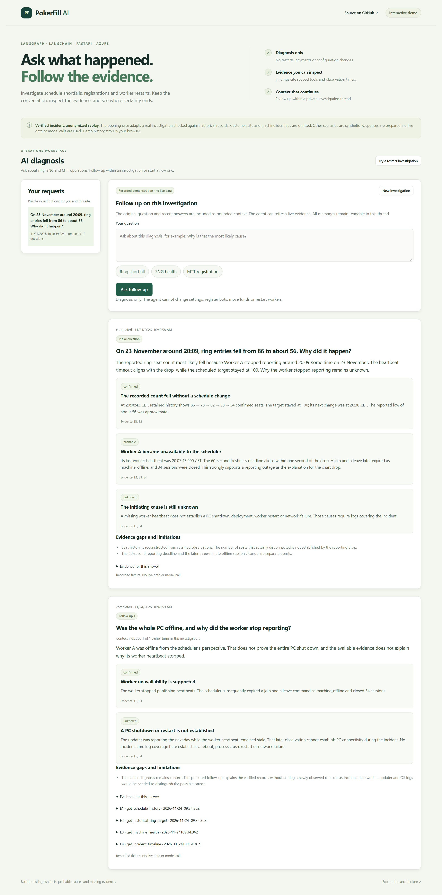
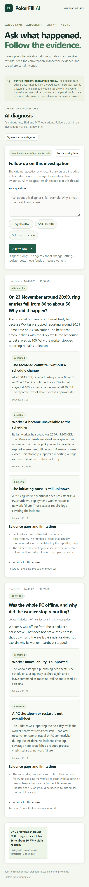
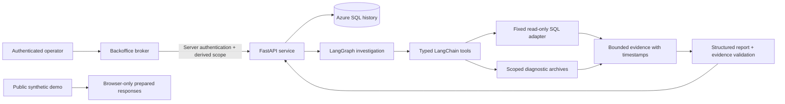

<p align="center"><strong>POKERFILL · AI DIAGNOSTICS</strong></p>

<h1 align="center">Ask what happened.<br>Follow the evidence.</h1>

<p align="center">An operational investigation assistant built with LangGraph, typed LangChain tools and FastAPI.<br>Scoped evidence, explicit uncertainty, and follow-up conversations that keep their context.</p>

<p align="center">
  <a href="https://github.com/biresevit/PokerFill-AI-Diagnostics/actions/workflows/ci.yml"></a>
  
  
  
</p>

<p align="center"><a href="https://pokerfill-ai-diagnostics.azurewebsites.net/demo"><strong>Explore the interactive demo ↗</strong></a> · <a href="#architecture">Architecture</a> · <a href="#run-locally">Run locally</a> · <a href="docs/deployment.md">Azure deployment</a></p>

> **Permitted use:** Associated poker bots are for research, practice in the [poker simulator](https://github.com/biresevit/simulator-portfolio), and authorized poker-client load or resilience testing. Do not run bots on real-money tables without disclosing their use to human players. This project provides operational diagnosis and does not play poker.



## The problem

PokerFill workers run on customer machines and interact with the native poker client and game server. When entries drop or joins fail, the problem can originate in PokerFill, on the customer's machine or account, or in the client or game server. A lost connection, a login failure, insufficient account funds, and a server-side bug can all look similar from the dashboard.

The agent correlates schedule history, worker logs, and operational records for the incident window. Each finding cites the evidence and is labelled **confirmed**, **probable**, or **unknown**. Customers can use the diagnosis to address issues they control, such as a local connection or account problem, and share the relevant evidence with PokerFill support or the game operator when escalation is needed. Follow-up questions can request fresh evidence within the same investigation.

The agent has read-only access for ring, SNG, and MTT investigations. An authenticated Backoffice broker can request diagnostic archives for the agent to inspect.

## What you can explore

| Capability | Engineering approach |
|---|---|
| Agentic investigation | LangGraph state machine with typed LangChain tools and structured report validation |
| Evidence grounding | Findings cite evidence IDs; missing, stale and truncated observations remain explicit |
| Follow-up conversations | Private threads, bounded context, latest-turn checks and reloadable evidence |
| Customer isolation | Scope comes from the authenticated server broker; each evidence read checks customer/site ownership |
| Operational tools | Schedule compliance, historical drops, eligibility, wallet coverage, lobby freshness, tournament registrations and incident timelines |
| Restart diagnosis | Scoped application archives, allowlisted timestamped events, PC timezone conversion and file coverage |
| Controlled execution | Fixed SQL templates, SELECT-only evidence adapter, queue/rate limits and model/tool budgets |
| Cloud persistence | Azure SQL investigation history; local SQLite for development |
| Secret handling | Server-side model credentials and managed-identity access to the diagnostic blob container |

## Sample investigations

The public demo opens with an **anonymized replay of a verified historical incident**, using prepared responses. Historical heartbeat, command, session and seat records were checked before publication. Customer and site identities are omitted, and the machine is labelled **Worker A**. Other scenarios use synthetic fixtures. This is not a live connection or a model benchmark; live investigations run through the authenticated Backoffice. See the [case study and verification limits](docs/case-study.md).

### Featured investigation: a sudden ring-entry drop

> **Question:** On 23 November around 20:09, ring entries fell from 86 to about 56. Why did it happen?
>
> **Diagnosis:** The reported count most likely fell because Worker A stopped reporting. Its 60-second heartbeat deadline aligns with the drop, while the scheduled target stayed at 100. Subsequent `machine_offline` command expiries and session closures support worker unavailability. The initiating cause remains unknown.

The verified history continues **86 → 73 → 62 → 58 → 54**; the original answer mentioned only the first part. The replay corrects that omission and distinguishes a reporting outage from a proven loss of actual poker seats. A follow-up asks whether the whole PC was offline: worker unavailability is supported, but a PC shutdown or restart is not established.

| User prompt | Illustrative diagnosis |
|---|---|
| “Why are fewer ring entries running than scheduled?” | “Workers are healthy, but lobby observations are stale. The sample has 52 confirmed seats against a target of 80. A funding shortage is not established.” |
| “Could low balances explain this too?” | “Unknown funds are not the same as insufficient funds. Eighteen accounts have no usable wallet observation; that does not prove they have zero funds.” |
| “Why are bots not registering for the Evening Open MTT?” | “Six configured accounts are cooling down, limiting eligible registration capacity to four. Missing wallet observations remain unknown.” |
| “Are SNG bots following their schedule?” | “Twelve confirmed registrations meet the target of twelve. Two games waiting for players are not failed registrations.” |
| “Why did Worker 212 restart around 20:02 CET?” | “Sample logs show a heartbeat timeout followed by a site-worker restart. The earlier deployment does not match the incident; the cause of the database interruption remains unconfirmed.” |

### Continue the investigation



<details><summary>Mobile view</summary>



</details>

## Architecture



An initial question establishes a schedule, machine-health and lobby baseline. The model selects additional tools within the investigation budget. Follow-ups begin with bounded conversation context and refresh operational evidence as needed. Previous diagnoses are context, not proof of current conditions.

The live PokerFill adapter uses a pinned, checksum-verified set of domain helpers from [PokerBackoffice](https://github.com/biresevit/PokerBackoffice). It is optional for the synthetic demo. The model receives fixed tools, not a SQL console, shell, browser or general HTTP client.

The Azure service uses one process and a bounded in-process queue. History survives process restarts in Azure SQL; interrupted jobs become visible failures rather than silently disappearing. This is a deliberately small deployment, not a distributed worker system. See [design decisions and limits](docs/architecture.md).

## Run locally

Python 3.11 or newer:

```bash
python -m venv .venv
# Activate .venv using your shell, then:
python -m pip install -e .
python scripts/run_demo.py
```

Open **http://127.0.0.1:8000/demo**. This command uses prepared browser fixtures, disables model access and does not connect to customer databases. The demo can be explored without an OpenAI account.

For the real integration, install the pinned domain helpers with `python scripts/vendor_backoffice.py`, configure the server settings in [.env.example](.env.example), and use an authenticated broker. No customer data, credentials or investigation history are included in this repository.

## Test

```bash
python -m pip install -r requirements-dev.txt -e .
python scripts/vendor_backoffice.py
python -m pytest -q
python -m playwright install chromium
python scripts/check_demo.py
```

Tests cover scope isolation, fixed SQL reads, conversation ownership and branching, context bounds, model-error handling, evidence references, archive limits, sensitive-data exclusion, lifecycle events and timezone handling. The browser check exercises follow-ups, reload, mobile layout, HTML escaping and the absence of live API calls in the public demo. CI does not require customer credentials or a model key.

## Deploy to Azure

The production service is hosted on **Azure App Service for Linux**. A small single-instance plan keeps the queue available; Azure SQL stores history, and managed identity reads the diagnostic blob container. Model credentials and the broker token remain in Azure application settings. The public demo does not carry either credential.

[Deployment instructions](docs/deployment.md) cover provisioning, SQL permissions, environment settings, deployment packages, identity and history migration. The repository includes a manually triggered deployment workflow using GitHub OIDC, with no Azure password stored in GitHub.

Hosting is separate from model usage. The Linux B1 plan is approximately **US$13/month** at published baseline pricing; region, currency and subscription pricing can differ. Model charges depend on the chosen model and evidence size, and usage is recorded per answer. [Azure pricing](https://azure.microsoft.com/en-us/pricing/details/app-service/linux/)

## Project layout

```text
src/pokerfill_ai/
  agent.py                 LangGraph workflow, typed tools and report validation
  service.py               Authenticated API, job bounds and conversation endpoints
  conversations.py         Context selection and compaction
  history_sql.py           Azure SQL history adapter
  integrations/pokerfill/  Fixed evidence reads and scoped log parsing
web/                       Reusable investigation UI and synthetic public demo
scripts/                   Pinned integration helpers, tests and release packaging
sql/                       Durable-history schema
docs/                      Architecture, deployment and real browser screenshots
```

Built by [biresevIT](https://github.com/biresevit). [MIT license](LICENSE).
